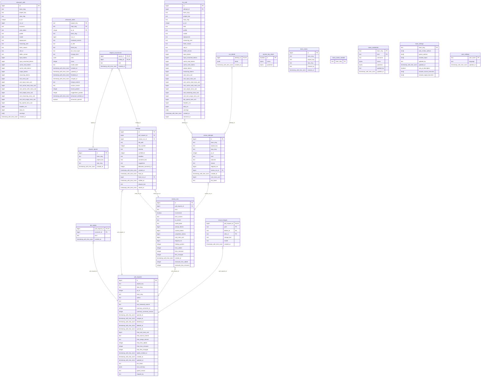

<!-- Generated by github.com/trick77/ship/kit/schemadoc, do not edit. Regenerate in the Go module directory: SCHEMADOC_UPDATE=1 go test ./... -run TestSchemaDoc -->

# Database schema

18 tables; the diagram is at the end. Go types are the `model.go` structs whose rows they hold.

## almanach_calls

| Column | Type | Null | Default | PK |
| --- | --- | --- | --- | --- |
| `id` | bigint | no | `nextval('almanach_calls_id_seq'::regclass)` | 1 |
| `team_slug` | text | no |  |  |
| `project_key` | text | no |  |  |
| `repo_slug` | text | no |  |  |
| `pr_id` | integer | no |  |  |
| `run_id` | bigint | yes |  |  |
| `outcome` | text | no |  |  |
| `note_status` | text | no |  |  |
| `profile` | text | yes |  |  |
| `model` | text | yes |  |  |
| `deployment` | text | yes |  |  |
| `reasoning_sent` | text | yes |  |  |
| `finish_reason` | text | yes |  |  |
| `call_id` | text | yes |  |  |
| `litellm_version` | text | yes |  |  |
| `input_tokens` | bigint | yes |  |  |
| `input_uncached_tokens` | bigint | yes |  |  |
| `cache_read_tokens` | bigint | yes |  |  |
| `cache_write_tokens` | bigint | yes |  |  |
| `output_tokens` | bigint | yes |  |  |
| `reasoning_tokens` | bigint | yes |  |  |
| `cost_nano_usd` | bigint | yes |  |  |
| `cost_input_nano_usd` | bigint | yes |  |  |
| `cost_cache_read_nano_usd` | bigint | yes |  |  |
| `cost_cache_write_nano_usd` | bigint | yes |  |  |
| `cost_output_nano_usd` | bigint | yes |  |  |
| `cost_reasoning_nano_usd` | bigint | yes |  |  |
| `cost_tool_usage_nano_usd` | bigint | yes |  |  |
| `key_spend_nano_usd` | bigint | yes |  |  |
| `headers_ms` | bigint | yes |  |  |
| `total_ms` | bigint | yes |  |  |
| `warnings` | text[] | no | `'{}'::text[]` |  |
| `created_at` | timestamp with time zone | no | `now()` |  |

Indexes:

- `almanach_calls_pr_idx` (`project_key`, `repo_slug`, `pr_id`, `created_at`)

Checks:

- `CONSTRAINT almanach_calls_note_status_check CHECK (note_status = ANY (ARRAY['written'::text, 'superseded'::text, 'already_emitted'::text, 'no_row'::text, 'store_failed'::text, 'nothing_learned'::text, 'dropped_too_long'::text, 'dropped_secret'::text, 'dropped_invalid'::text, 'no_answer'::text]))`

## almanach_notes

Go types:

- `store.AlmanachNote` (internal/store): AlmanachNote is one PR's documentation note as a review round leaves it. See migrations/0018_almanach.sql: every round replaces the row, ordered by RunID; the merge stamps it final; the forwarder marks it emitted.
- `store.AlmanachNoteState` (internal/store): AlmanachNoteState is what a caller reads back before deciding to emit.
- `store.AlmanachPending` (internal/store): AlmanachPending is one final note the forwarder sends, with everything Almanach gets beside it.

| Column | Type | Null | Default | PK |
| --- | --- | --- | --- | --- |
| `project_key` | text | no |  | 1 |
| `repo_slug` | text | no |  | 2 |
| `pr_id` | integer | no |  | 3 |
| `team_slug` | text | no |  |  |
| `run_id` | bigint | yes |  |  |
| `reviewed_commit` | text | yes |  |  |
| `pr_title` | text | no |  |  |
| `ticket_key` | text | yes |  |  |
| `jira_issue_type` | text | yes |  |  |
| `change_kind` | text | yes |  |  |
| `note` | jsonb | yes |  |  |
| `chars` | integer | yes |  |  |
| `model_label` | text | yes |  |  |
| `created_at` | timestamp with time zone | no | `now()` |  |
| `updated_at` | timestamp with time zone | no | `now()` |  |
| `finalized_at` | timestamp with time zone | yes |  |  |
| `merged_at` | timestamp with time zone | yes |  |  |
| `merge_commit` | text | yes |  |  |
| `source_commit` | text | yes |  |  |
| `issues_posted` | integer | yes |  |  |
| `suggestions_posted` | integer | yes |  |  |
| `almanach_emitted_at` | timestamp with time zone | yes |  |  |
| `almanach_ignored` | boolean | no | `false` |  |

Indexes:

- `almanach_notes_ignored_idx` (`almanach_emitted_at`) where `almanach_ignored`
- `almanach_notes_pending_idx` (`team_slug`, `finalized_at`) where `finalized_at IS NOT NULL AND note IS NOT NULL AND almanach_emitted_at IS NULL`

## bot_replies

Go types:

- `store.BotReply` (internal/store): BotReply is one reply noergler posted, by its Bitbucket comment id.

| Column | Type | Null | Default | PK |
| --- | --- | --- | --- | --- |
| `pull_request_id` | bigint | no |  | 1 |
| `comment_id` | bigint | no |  | 2 |
| `kind` | text | no |  |  |
| `created_at` | timestamp with time zone | no | `now()` |  |

Foreign keys:

- `pull_request_id` → `pull_requests` (`id`), on delete CASCADE

Checks:

- `CONSTRAINT bot_replies_kind_check CHECK (kind = ANY (ARRAY['question'::text, 'reply'::text, 'fixed'::text]))`

## dispute_occurrences

| Column | Type | Null | Default | PK |
| --- | --- | --- | --- | --- |
| `signal_id` | bigint | no |  | 1 |
| `finding_id` | bigint | no |  | 2 |
| `rule` | text | no |  |  |
| `created_at` | timestamp with time zone | no | `now()` |  |

Foreign keys:

- `finding_id` → `findings` (`id`), on delete CASCADE
- `signal_id` → `dispute_signals` (`id`), on delete CASCADE

Indexes:

- `idx_dispute_occurrences_finding` (`finding_id`)
- `idx_dispute_occurrences_time` (`signal_id`, `created_at`)

## dispute_signals

Go types:

- `store.DisputeSignal` (internal/store): DisputeSignal is one open signal of a repo: its id and the rule as the newest occurrence in the window worded it.

| Column | Type | Null | Default | PK |
| --- | --- | --- | --- | --- |
| `id` | bigint | no | `nextval('dispute_signals_id_seq'::regclass)` | 1 |
| `team_slug` | text | no |  |  |
| `project_key` | text | no |  |  |
| `repo_slug` | text | no |  |  |
| `created_at` | timestamp with time zone | no | `now()` |  |

Indexes:

- `idx_dispute_signals_repo` (`team_slug`, `project_key`, `repo_slug`)

## findings

Go types:

- `store.Finding` (internal/store): Finding is one posted inline comment.
- `store.RunFinding` (internal/store): RunFinding is a posted finding as the pages show it: where, how bad, its text, the Bitbucket comment it was posted as, and the runs that posted and retired it.

| Column | Type | Null | Default | PK |
| --- | --- | --- | --- | --- |
| `id` | bigint | no | `nextval('findings_id_seq'::regclass)` | 1 |
| `pull_request_id` | bigint | no |  |  |
| `review_run_id` | bigint | no |  |  |
| `file_path` | text | no |  |  |
| `line_number` | integer | no |  |  |
| `severity` | text | no |  |  |
| `confidence` | integer | yes |  |  |
| `headline` | text | yes |  |  |
| `comment_text` | text | no |  |  |
| `suggestion` | text | yes |  |  |
| `bitbucket_comment_id` | integer | yes |  |  |
| `created_at` | timestamp with time zone | no | `now()` |  |
| `fixed_at` | timestamp with time zone | yes |  |  |
| `fixed_run_id` | bigint | yes |  |  |
| `replied_at` | timestamp with time zone | yes |  |  |
| `dispute_text` | text | yes |  |  |
| `closed_at` | timestamp with time zone | yes |  |  |

Foreign keys:

- `fixed_run_id` → `review_runs` (`id`), on delete SET NULL
- `pull_request_id` → `pull_requests` (`id`), on delete CASCADE
- `review_run_id` → `review_runs` (`id`), on delete CASCADE

Indexes:

- `idx_findings_comment` (`bitbucket_comment_id`)
- `idx_findings_dedup` (`pull_request_id`, `file_path`, `line_number`, `severity`)

## llm_calls

Go types:

- `store.CommentCall` (internal/store): CommentCall is one reply or question call on a PR, for the run page's list. Nil cost = unpriced.
- `store.LLMCall` (internal/store): LLMCall is one gateway call as the AI Gateway described it. See migrations/0009_llm_calls.sql and 0012: every pointer is nil when the gateway did not send that figure, which is not zero. A review call's CostNanoUSD is detail beside the run or attempt that carries the cost; a reply's or a question's is the only record of it, and the PR cost sums it.

| Column | Type | Null | Default | PK |
| --- | --- | --- | --- | --- |
| `id` | bigint | no | `nextval('llm_calls_id_seq'::regclass)` | 1 |
| `attempt_id` | bigint | yes |  |  |
| `team_slug` | text | no |  |  |
| `project_key` | text | no |  |  |
| `repo_slug` | text | no |  |  |
| `pr_id` | integer | no |  |  |
| `kind` | text | no |  |  |
| `profile` | text | no |  |  |
| `model` | text | yes |  |  |
| `deployment` | text | yes |  |  |
| `reasoning_sent` | text | yes |  |  |
| `finish_reason` | text | yes |  |  |
| `call_id` | text | yes |  |  |
| `litellm_version` | text | yes |  |  |
| `input_tokens` | bigint | yes |  |  |
| `input_uncached_tokens` | bigint | yes |  |  |
| `cache_read_tokens` | bigint | yes |  |  |
| `cache_write_tokens` | bigint | yes |  |  |
| `output_tokens` | bigint | yes |  |  |
| `reasoning_tokens` | bigint | yes |  |  |
| `cost_nano_usd` | bigint | yes |  |  |
| `cost_input_nano_usd` | bigint | yes |  |  |
| `cost_cache_read_nano_usd` | bigint | yes |  |  |
| `cost_cache_write_nano_usd` | bigint | yes |  |  |
| `cost_output_nano_usd` | bigint | yes |  |  |
| `cost_reasoning_nano_usd` | bigint | yes |  |  |
| `cost_tool_usage_nano_usd` | bigint | yes |  |  |
| `key_spend_nano_usd` | bigint | yes |  |  |
| `headers_ms` | bigint | yes |  |  |
| `total_ms` | bigint | yes |  |  |
| `warnings` | text[] | no | `'{}'::text[]` |  |
| `created_at` | timestamp with time zone | no | `now()` |  |
| `comment_id` | bigint | yes |  |  |

Foreign keys:

- `attempt_id` → `review_attempts` (`id`), on delete CASCADE

Indexes:

- `idx_llm_calls_attempt` (`attempt_id`) unique where `attempt_id IS NOT NULL`
- `idx_llm_calls_pr` (`project_key`, `repo_slug`, `pr_id`)
- `llm_calls_comment_pr_idx` (`project_key`, `repo_slug`, `pr_id`, `created_at`) where `attempt_id IS NULL`

Checks:

- `CONSTRAINT llm_calls_attempt_kind_check CHECK ((kind = 'review'::text) = (attempt_id IS NOT NULL))`
- `CONSTRAINT llm_calls_kind_check CHECK (kind = ANY (ARRAY['review'::text, 'reply'::text, 'question'::text]))`

## pull_requests

Go types:

- `store.PRKey` (internal/store): PRKey identifies a pull request across Bitbucket and the store.
- `store.PRStatus` (internal/store): PRStatus is what noergler knows about one PR: the answer to "why was my PR (not) reviewed?". Read-only, and nothing in it is author text: no finding, no dispute.
- `store.SkipState` (internal/store): SkipState is what the review guard needs to decide whether to skip a PR.
- `store.prRow` (internal/store): prRow is the PR row behind a page token.

| Column | Type | Null | Default | PK |
| --- | --- | --- | --- | --- |
| `id` | bigint | no | `nextval('pull_requests_id_seq'::regclass)` | 1 |
| `project_key` | text | no |  |  |
| `repo_slug` | text | no |  |  |
| `pr_id` | integer | no |  |  |
| `team_slug` | text | no |  |  |
| `author` | text | yes |  |  |
| `title` | text | yes |  |  |
| `last_reviewed_commit` | text | yes |  |  |
| `summary_comment_id` | integer | yes |  |  |
| `summary_comment_version` | integer | yes |  |  |
| `opened_at` | timestamp with time zone | yes |  |  |
| `merged_at` | timestamp with time zone | yes |  |  |
| `declined_at` | timestamp with time zone | yes |  |  |
| `deleted_at` | timestamp with time zone | yes |  |  |
| `ignored_at` | timestamp with time zone | yes |  |  |
| `final_cost_nano_usd` | bigint | yes |  |  |
| `final_source_commit` | text | yes |  |  |
| `final_merge_commit` | text | yes |  |  |
| `final_lines_added` | integer | yes |  |  |
| `final_lines_removed` | integer | yes |  |  |
| `final_files_changed` | integer | yes |  |  |
| `riptide_emitted_at` | timestamp with time zone | yes |  |  |
| `created_at` | timestamp with time zone | no | `now()` |  |
| `updated_at` | timestamp with time zone | no | `now()` |  |
| `link_token` | text | no | `rtrim(translate(encode(uuid_send(gen_random_uuid()), 'base64'::text), '+/'::text, '-_'::text), '='::text)` |  |
| `last_summary` | jsonb | yes |  |  |
| `ignore_reason` | text | yes |  |  |
| `stopped_by` | text | yes |  |  |

Indexes:

- `idx_pull_requests_lifecycle` (`merged_at`, `deleted_at`)
- `idx_pull_requests_team` (`team_slug`)
- `pull_requests_link_token_key` (`link_token`) unique
- `pull_requests_project_key_repo_slug_pr_id_key` (`project_key`, `repo_slug`, `pr_id`) unique

Checks:

- `CONSTRAINT pull_requests_ignore_reason_check CHECK (ignore_reason = ANY (ARRAY['summary_deleted'::text, 'stopped'::text]))`
- `CONSTRAINT pull_requests_ignore_reason_set CHECK ((ignored_at IS NULL) = (ignore_reason IS NULL))`

## review_attempts

Go types:

- `store.Attempt` (internal/store): Attempt is one terminal outcome, including the ones that write no run row. See migrations/0002_review_attempts.sql for why this is its own table.
- `store.AttemptBrief` (internal/store): AttemptBrief is one terminal outcome.
- `store.AttemptRow` (internal/store): AttemptRow is one row of the dashboard's feed: the attempt, plus the run figures where the attempt produced a run.
- `store.PRRun` (internal/store): PRRun is one attempt as the PR page lists it.
- `store.RunDetail` (internal/store): RunDetail is everything the run page shows about one attempt.

| Column | Type | Null | Default | PK |
| --- | --- | --- | --- | --- |
| `id` | bigint | no | `nextval('review_attempts_id_seq'::regclass)` | 1 |
| `team_slug` | text | no |  |  |
| `project_key` | text | no |  |  |
| `repo_slug` | text | no |  |  |
| `pr_id` | integer | no |  |  |
| `kind` | text | no |  |  |
| `outcome` | text | no |  |  |
| `reason` | text | yes |  |  |
| `elapsed_ms` | bigint | yes |  |  |
| `review_run_id` | bigint | yes |  |  |
| `created_at` | timestamp with time zone | no | `now()` |  |
| `cost_nano_usd` | bigint | yes |  |  |
| `link_token` | text | no | `rtrim(translate(encode(uuid_send(gen_random_uuid()), 'base64'::text), '+/'::text, '-_'::text), '='::text)` |  |

Foreign keys:

- `review_run_id` → `review_runs` (`id`), on delete SET NULL

Indexes:

- `idx_attempts_pr` (`project_key`, `repo_slug`, `pr_id`)
- `idx_attempts_recent` (`created_at`)
- `idx_attempts_run` (`review_run_id`) where `review_run_id IS NOT NULL`
- `idx_attempts_team` (`team_slug`, `created_at`)
- `review_attempts_link_token_key` (`link_token`) unique

Checks:

- `CONSTRAINT review_attempts_kind_check CHECK (kind = ANY (ARRAY['auto'::text, 'mention'::text]))`
- `CONSTRAINT review_attempts_outcome_check CHECK (outcome = ANY (ARRAY['ok'::text, 'timed_out'::text, 'unparseable'::text, 'too_large'::text, 'error'::text, 'skipped'::text]))`

## review_runs

Go types:

- `store.RunBrief` (internal/store): RunBrief is one review run, without its tokens or cost.
- `store.RunFacts` (internal/store): RunFacts is the review_runs row behind a successful attempt.

| Column | Type | Null | Default | PK |
| --- | --- | --- | --- | --- |
| `id` | bigint | no | `nextval('review_runs_id_seq'::regclass)` | 1 |
| `pull_request_id` | bigint | no |  |  |
| `kind` | text | no |  |  |
| `incremental` | boolean | no |  |  |
| `from_commit` | text | yes |  |  |
| `to_commit` | text | no |  |  |
| `model_label` | text | no |  |  |
| `prompt_tokens` | bigint | no |  |  |
| `cached_tokens` | bigint | no |  |  |
| `completion_tokens` | bigint | no |  |  |
| `cost_nano_usd` | bigint | yes |  |  |
| `elapsed_ms` | bigint | no |  |  |
| `findings_posted` | integer | no |  |  |
| `lines_added` | integer | no |  |  |
| `lines_removed` | integer | no |  |  |
| `files_changed` | integer | no |  |  |
| `created_at` | timestamp with time zone | no | `now()` |  |
| `reviewed_lines_added` | integer | yes |  |  |
| `reviewed_lines_removed` | integer | yes |  |  |

Foreign keys:

- `pull_request_id` → `pull_requests` (`id`), on delete CASCADE

Indexes:

- `idx_review_runs_created` (`created_at`)
- `idx_review_runs_pr` (`pull_request_id`)

Checks:

- `CONSTRAINT review_runs_kind_check CHECK (kind = ANY (ARRAY['auto'::text, 'mention'::text]))`

## run_details

| Column | Type | Null | Default | PK |
| --- | --- | --- | --- | --- |
| `attempt_id` | bigint | no |  | 1 |
| `detail` | jsonb | no |  |  |
| `created_at` | timestamp with time zone | no | `now()` |  |

Foreign keys:

- `attempt_id` → `review_attempts` (`id`), on delete CASCADE

## secrets_key_check

| Column | Type | Null | Default | PK |
| --- | --- | --- | --- | --- |
| `id` | boolean | no | `true` | 1 |
| `nonce` | bytea | no |  |  |
| `ciphertext` | bytea | no |  |  |

Checks:

- `CONSTRAINT secrets_key_check_id_check CHECK (id)`

## team_claims

Go types:

- `store.claimRow` (internal/store): claimRow is one team_claims row as the claim reads take it.

| Column | Type | Null | Default | PK |
| --- | --- | --- | --- | --- |
| `id` | bigint | no | `nextval('team_claims_id_seq'::regclass)` | 1 |
| `team_slug` | text | no |  |  |
| `project_key` | text | no |  |  |
| `repo_slug` | text | yes |  |  |
| `claimed_by` | text | no |  |  |
| `claimed_at` | timestamp with time zone | no | `now()` |  |

Indexes:

- `idx_team_claims_team` (`team_slug`)
- `uq_team_claims_project` (`project_key`) unique where `repo_slug IS NULL`
- `uq_team_claims_repo` (`project_key`, `repo_slug`) unique where `repo_slug IS NOT NULL`

## team_claims_seeded

| Column | Type | Null | Default | PK |
| --- | --- | --- | --- | --- |
| `team_slug` | text | no |  | 1 |

## team_credentials

Go types:

- `store.SealedCredential` (internal/store): SealedCredential is one team_credentials row: the token as ciphertext only. Sealing and opening are the caller's (internal/teams); the store never sees a token in the clear.

| Column | Type | Null | Default | PK |
| --- | --- | --- | --- | --- |
| `team_slug` | text | no |  | 1 |
| `kind` | text | no |  | 2 |
| `username` | text | yes |  |  |
| `nonce` | bytea | no |  |  |
| `ciphertext` | bytea | no |  |  |
| `updated_by` | text | yes |  |  |
| `updated_at` | timestamp with time zone | no | `now()` |  |

Checks:

- `CONSTRAINT team_credentials_kind_check CHECK (kind = ANY (ARRAY['bitbucket'::text, 'jira'::text]))`

## team_settings

Go types:

- `store.TeamSettings` (internal/store): TeamSettings are the per-team review settings held in the DB.

| Column | Type | Null | Default | PK |
| --- | --- | --- | --- | --- |
| `team_slug` | text | no |  | 1 |
| `auto_review_authors` | text[] | no | `'{}'::text[]` |  |
| `ignore_authors` | text[] | no | `'{}'::text[]` |  |
| `exclude_repos` | text[] | no | `'{*-infra}'::text[]` |  |
| `updated_by` | text | yes |  |  |
| `updated_at` | timestamp with time zone | no | `now()` |  |
| `use_pr_description` | boolean | no | `true` |  |
| `exclude_source_branches` | text[] | no | `'{}'::text[]` |  |
| `exclude_target_branches` | text[] | no | `'{}'::text[]` |  |

## user_settings

| Column | Type | Null | Default | PK |
| --- | --- | --- | --- | --- |
| `user_name` | text | no |  | 1 |
| `language` | text | no |  |  |
| `updated_at` | timestamp with time zone | no | `now()` |  |

Checks:

- `CONSTRAINT user_settings_language_check CHECK (language = ANY (ARRAY['de'::text, 'en'::text]))`

## visual_changes

Go types:

- `store.VisualPair` (internal/store): VisualPair identifies one screenshot pair by content, migrations/ 0023_visual_changes.sql. BeforeID is "" for an added screenshot.

| Column | Type | Null | Default | PK |
| --- | --- | --- | --- | --- |
| `pull_request_id` | bigint | no |  | 1 |
| `path` | text | no |  | 2 |
| `before_id` | text | no |  | 3 |
| `after_id` | text | no |  | 4 |
| `change_text` | text | no |  |  |
| `model` | text | no |  |  |
| `created_at` | timestamp with time zone | no | `now()` |  |

Foreign keys:

- `pull_request_id` → `pull_requests` (`id`), on delete CASCADE

## Types not stored as rows

### store.AlmanachReviewTotals

In `internal/store`. AlmanachReviewTotals is the PR's review aggregate: the runs, their tokens, and the PR's cost as prCostSQL counts it (the one figure the cap, the frozen cost and the rollup use). Zero and nil when the PR row is gone.

| Field | Type | Doc |
| --- | --- | --- |
| `Runs` | `int` |  |
| `PromptTokens` | `int64` |  |
| `CachedTokens` | `int64` |  |
| `CompletionTokens` | `int64` |  |
| `ElapsedMS` | `int64` |  |
| `CostNanoUSD` | `*int64` |  |
| `Models` | `[]string` |  |

### store.AttemptBucket

In `internal/store`. AttemptBucket is one day's count for one outcome.

| Field | Type | Doc |
| --- | --- | --- |
| `Day` | `time.Time` |  |
| `Outcome` | `string` |  |
| `Count` | `int` |  |

### store.Bucket

In `internal/store`. Bucket is one day of the timeseries.

| Field | Type | Doc |
| --- | --- | --- |
| `Day` | `time.Time` |  |
| `TeamSlug` | `string` |  |
| `Runs` | `int` |  |
| `FindingsPosted` | `int64` |  |
| `CostNanoUSD` | `*int64` |  |
| `Unpriced` | `int` | Unpriced is how many of the day's runs carried no cost, as in Totals. |
| `Lines` | `int64` | Lines is the day's lines reviewed, added plus removed, as in Totals. |

### store.DisputePR

In `internal/store`. DisputePR is one PR a signal occurred on inside the window: the Bitbucket PR number, the disputed finding's comment (nil if never posted) and the PR author.

| Field | Type | Doc |
| --- | --- | --- |
| `PRID` | `int` |  |
| `CommentID` | `*int` |  |
| `Author` | `string` |  |

### store.OutcomeCount

In `internal/store`. OutcomeCount is one bucket of the outcome breakdown.

| Field | Type | Doc |
| --- | --- | --- |
| `Outcome` | `string` |  |
| `Reason` | `string` |  |
| `Count` | `int` |  |

### store.PRTotals

In `internal/store`. PRTotals add up over every attempt of the PR.

| Field | Type | Doc |
| --- | --- | --- |
| `Runs` | `int` |  |
| `ElapsedMS` | `int64` |  |
| `PromptTokens` | `int64` |  |
| `CachedTokens` | `int64` |  |
| `CompletionTokens` | `int64` |  |

### store.RollupSnapshot

In `internal/store`. RollupSnapshot is what one riptide rollup carries.

| Field | Type | Doc |
| --- | --- | --- |
| `Runs` | `int` |  |
| `PromptTokens` | `int64` |  |
| `CompletionTokens` | `int64` |  |
| `ElapsedMS` | `int64` |  |
| `Findings` | `int` |  |
| `CostNanoUSD` | `*int64` | CostNanoUSD is nil when no run was priced. |
| `Models` | `[]string` |  |
| `FirstReviewAt` | `time.Time` |  |
| `SourceCommit` | `*string` |  |
| `MergeCommit` | `*string` |  |
| `LinesAdded` | `*int` |  |
| `LinesRemoved` | `*int` |  |
| `FilesChanged` | `*int` |  |

### store.TeamActivity

In `internal/store`. TeamActivity is the per-team roster figure: how many PRs a team has touched, when it last produced a review, and when and how its last run of any outcome ended.

| Field | Type | Doc |
| --- | --- | --- |
| `TeamSlug` | `string` |  |
| `PRs` | `int` |  |
| `LastReviewed` | `*time.Time` | LastReviewed is the last SUCCESS: review_runs holds nothing else. |
| `LastRun` | `*time.Time` | LastRun is the last run of any outcome, skips and failures included. Nil when the team has none. |
| `LastOutcome` | `string` | LastOutcome is LastRun's outcome. |
| `LastReason` | `string` | LastReason is LastRun's skip reason. |

### store.TeamTotals

In `internal/store`. TeamTotals is Totals for one team.

| Field | Type | Doc |
| --- | --- | --- |
| `TeamSlug` | `string` |  |
| `Totals` (embedded) | `Totals` |  |

### store.Totals

In `internal/store`. Totals is the headline figure set over a time window.

| Field | Type | Doc |
| --- | --- | --- |
| `Runs` | `int` |  |
| `PromptTokens` | `int64` |  |
| `CachedTokens` | `int64` |  |
| `CompletionTokens` | `int64` |  |
| `FindingsPosted` | `int64` |  |
| `CostNanoUSD` | `*int64` | CostNanoUSD sums the priced runs and billed run-less attempts. Nil when none were priced. |
| `Unpriced` | `int` | Unpriced is how many runs carried no cost. Shown beside the total, never added to it. |
| `LinesAdded` | `int64` | LinesAdded and LinesRemoved are the lines reviewed: the +/- of the files the prompt carried, counted once per PR (spendCTE). |
| `LinesRemoved` | `int64` | see `LinesAdded` |
| `LinesUncounted` | `int` | LinesUncounted is how many runs predate the column (migration 0029) and add no lines, so the page can say the figure reads low. |

## Diagram

